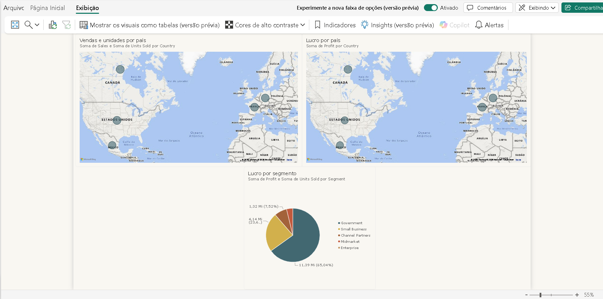

# Desafio 1 · Power BI: Visuais com a base Financial Sample

Projeto do primeiro desafio do curso de Power BI da DIO. A proposta é replicar duas páginas do curso com a base Financial Sample e criar uma terceira página do zero, com visuais de vendas, unidades e lucro.

## Visualização

## Visuais da página 3

| Visual | Tipo | Campos principais | Dicas de ferramenta |
|---|---|---|---|
| Vendas e unidades por país | Mapa | Localização: Country · Tamanho: Sales | Units Sold |
| Lucro por país | Mapa | Localização: Country · Tamanho: Profit | - |
| Lucro por segmento | Gráfico de pizza | Legenda: Segment · Valores: Profit | Units Sold |

## Base de dados

- **Financial Sample** (Microsoft), com 700 registros, 5 países e 6 segmentos de negócio.
- Na importação, a coluna " Sales" foi renomeada para "Sales", retirando o espaço inicial.

## Estrutura do repositório

| Arquivo | Descrição |
|---|---|
| `Desafio1_PowerBI_Thalia.pbix` | Projeto do Power BI Desktop |
| `Financial_Sample.xlsx` | Base de dados utilizada |
| `codigo_power_query.txt` | Código do Editor Avançado (Power Query) |
| `print_pagina3.png` | Captura da página final |

## Como reproduzir

1. Abra o arquivo `Desafio1_PowerBI_Thalia.pbix` no Power BI Desktop.
2. Se o aviso de atualização de dados aparecer, aponte a fonte para o arquivo `Financial_Sample.xlsx` deste repositório.
3. Para ver a transformação aplicada, use **Página Inicial > Transformar dados > Editor Avançado** e compare com o conteúdo de `codigo_power_query.txt`.

## Relatório publicado

[[Link do relatório no Power BI Service](https://app.powerbi.com/links/WQrOGxxBKe?ctid=659ce2b8-0714-4198-8c38-dc9b60aabb57&pbi_source=linkShare)]

## Tecnologias

- Power BI Desktop
- Power Query (linguagem M)

## Autora

Thalia Menezes · [GitHub](https://github.com/thaliamenezes-98) · [LinkedIn]([https://www.linkedin.com/in/SEU-PERFIL](https://www.linkedin.com/in/thalia-menezes/))
